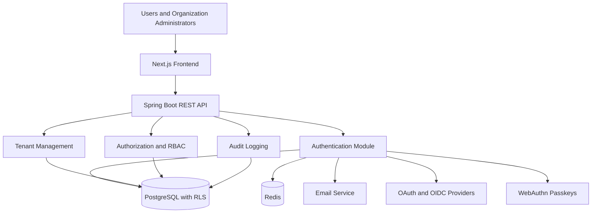

# Secure Identity Hub

## Multi-Tenant Authentication and Identity Management Platform

**One platform. Secure identities. Isolated organizations.**

Secure Identity Hub is a full-stack identity and access management platform designed to provide secure authentication, organization-level access control, and tenant isolation for modern SaaS applications.

The project aims to integrate modern authentication mechanisms with centralized identity management, granular authorization, and security auditing within a modular and maintainable architecture.

**Project Status:** Under Development  
**Project Type:** Final-Year Major Project

---

## Overview

Managing user identities across multiple organizations requires more than a basic login system. Applications must protect credentials, enforce permissions, manage sessions, and prevent unauthorized access between organizations.

Secure Identity Hub addresses these challenges through a multi-tenant architecture that combines centralized authentication with organization-scoped authorization.

The platform is designed to support multiple authentication methods, secure token lifecycle management, organization membership management, and tamper-evident audit logging.

## Key Features

### Authentication and Identity Management

- User registration and email verification.
- Secure password hashing.
- Login, logout, and password reset.
- OAuth 2.0 and OpenID Connect authentication with Google and GitHub.
- Passwordless authentication using WebAuthn passkeys.
- Single-use magic-link authentication.
- User profile and credential management.

### Multi-Tenant Architecture

- Organization creation and management.
- Multiple organization memberships per user.
- Organization invitations and membership management.
- Organization-specific roles and permissions.
- Secure organization switching.
- Tenant-level data isolation using PostgreSQL Row-Level Security (RLS).

### Authorization and Security

- Role-Based Access Control (RBAC).
- Backend-enforced permission checks.
- JWT access-token validation.
- Refresh-token rotation and reuse detection.
- Session management and revocation.
- Authentication rate limiting.
- Protection against cross-tenant data access.

### Security Auditing

- Authentication and authorization event logging.
- Organization membership and role-change tracking.
- Session and credential lifecycle events.
- Tamper-evident audit-log verification.
- Security event filtering and investigation.

### Administration Dashboard

- Organization and member management.
- User session and credential management.
- Application registration management.
- Audit log exploration.
- Security configuration and monitoring.

*Feature availability depends on implementation progress. Refer to the project documentation for the current implementation status.*

---

## Technology Stack

| Technology | Purpose |
|---|---|
| Java 21 | Backend development |
| Spring Boot | REST API and application architecture |
| Spring Security | Authentication and authorization |
| Spring Data JPA | Database persistence |
| PostgreSQL | Relational database |
| PostgreSQL RLS | Tenant-level data isolation |
| Redis | Rate limiting and transient data |
| Next.js | Frontend application |
| TypeScript | Type-safe frontend development |
| Tailwind CSS | Responsive user interface |
| Flyway | Database schema migrations |
| Maven | Backend build management |
| Docker | Containerization |
| GitHub Actions | Continuous integration |
| JUnit 5 and Testcontainers | Automated and integration testing |

---

## System Architecture

Secure Identity Hub follows a modular monolithic architecture that separates identity management, authentication, tenant management, authorization, and auditing responsibilities.



### Architecture Principles

- Separation of concerns through modular backend packages.
- Validated access tokens for API authentication.
- Server-side authorization for every protected operation.
- Tenant context validation before accessing organization data.
- Defense in depth using application checks and PostgreSQL RLS.
- Database transactions for sensitive token and membership operations.
- Automated testing of security boundaries and failure scenarios.

---

## Security Design

Security is a core design requirement rather than an optional feature.

The planned implementation includes:

- Argon2id password hashing.
- Short-lived JWT access tokens.
- Hashed, opaque refresh tokens with rotation and reuse detection.
- Secure session revocation.
- OAuth/OIDC callback and token validation.
- WebAuthn challenge and signature verification using a maintained library.
- Organization-scoped authorization checks.
- PostgreSQL RLS with appropriately restricted database roles.
- Rate limiting for sensitive authentication endpoints.
- Sanitized logs that exclude credentials and authentication secrets.
- Append-only audit records with cryptographic integrity verification.

**Security note:** These controls must be implemented and tested before the platform can be considered production-ready. Design documentation alone does not establish security.

---

## Planned Project Structure

```text
secure-identity-hub/
├── backend/
│   ├── src/
│   │   ├── main/
│   │   │   ├── java/
│   │   │   │   └── .../
│   │   │   │       ├── identity/
│   │   │   │       ├── authentication/
│   │   │   │       ├── tenant/
│   │   │   │       ├── authorization/
│   │   │   │       ├── audit/
│   │   │   │       ├── notification/
│   │   │   │       └── common/
│   │   │   └── resources/
│   │   │       └── db/migration/
│   │   └── test/
│   └── pom.xml
├── frontend/
│   ├── app/
│   ├── components/
│   ├── lib/
│   ├── types/
│   └── package.json
├── docs/
│   ├── architecture.md
│   ├── security.md
│   ├── threat-model.md
│   ├── database-design.md
│   ├── api-guide.md
│   └── deployment.md
├── docker-compose.yml
├── .env.example
├── .gitignore
└── README.md
```

This represents the intended structure. Update it to reflect the actual repository as development progresses.

---

## Prerequisites

Install the following tools before running the application:

- Java Development Kit (JDK) 21.
- Maven or the included Maven Wrapper.
- Node.js LTS and npm.
- Docker Desktop with Docker Compose.
- Git.
- A code editor such as IntelliJ IDEA or Visual Studio Code.

External OAuth credentials and email configuration are required for their respective integrations. Passkey testing requires a supported browser and an appropriate local or deployed origin.

## Getting Started

### 1. Clone the Repository

```bash
git clone https://github.com/Tushar-source-lab/secure-identity-hub.git
cd secure-identity-hub
```

Replace the repository URL if your GitHub username or repository location differs.

### 2. Configure Environment Variables

Create a local environment file from the example:

```bash
cp .env.example .env
```

On Windows PowerShell:

```powershell
Copy-Item .env.example .env
```

Configure the required database, Redis, email, OAuth, and cryptographic settings.

Never commit `.env` files containing secrets, production credentials, or private signing keys.

### 3. Start Infrastructure

If the Docker Compose configuration has been implemented, start the development dependencies:

```bash
docker compose up -d postgres redis mailpit
```

Verify that the services are healthy before starting the backend.

### 4. Run Database Migrations

Use the configured Flyway migration process. Refer to the backend setup documentation for the actual migration command.

### 5. Start the Backend

From the backend directory:

```bash
./mvnw spring-boot:run
```

On Windows:

```powershell
.\mvnw.cmd spring-boot:run
```

If a Maven Wrapper is not included, use an installed Maven version.

### 6. Start the Frontend

From the frontend directory:

```bash
npm install
npm run dev
```

Open the local URL printed by the Next.js development server.

These commands describe the intended workflow and depend on the corresponding project files, services, migrations, and environment configuration being available.

---

## Testing

The project is intended to include unit tests, database integration tests, API tests, and end-to-end tests.

Run backend tests:

```bash
./mvnw test
```

Run frontend checks using the scripts configured in `package.json`:

```bash
npm run lint
npm run build
```

### Critical Security Test Scenarios

- A user cannot read another organization's records by changing an ID.
- An organization member cannot assign themselves an unauthorized role.
- Expired or previously used magic links cannot authenticate users.
- Replayed refresh tokens trigger the defined reuse-detection policy.
- Concurrent refresh requests cannot create inconsistent token states.
- Database connection reuse cannot leak tenant context.
- Unauthorized users cannot access audit logs.
- Modifications to audit-chain records are detected by the integrity verifier.

Security tests must verify that unauthorized operations are rejected, not merely that valid logins succeed.

---

## API Documentation

The backend is intended to expose REST endpoints under `/api/v1`.

| Area | Example Endpoint |
|---|---|
| Authentication | `/api/v1/auth/login` |
| Registration | `/api/v1/auth/register` |
| Token refresh | `/api/v1/auth/refresh` |
| User profile | `/api/v1/users/me` |
| Organizations | `/api/v1/organizations` |
| Memberships | `/api/v1/organizations/{id}/members` |
| Invitations | `/api/v1/organizations/{id}/invitations` |
| Sessions | `/api/v1/sessions` |
| Audit logs | `/api/v1/organizations/{id}/audit-events` |

These are proposed endpoint examples. The final API contract should reflect the implemented routes and be documented through the generated OpenAPI specification.

---

## Development Roadmap

- [ ] Project structure and development environment.
- [ ] PostgreSQL schema and Flyway migrations.
- [ ] Registration, email verification, and password authentication.
- [ ] Organization creation and membership management.
- [ ] RBAC and backend permission checks.
- [ ] PostgreSQL RLS and tenant-isolation tests.
- [ ] JWT validation and refresh-token rotation.
- [ ] Session management and revocation.
- [ ] Google and GitHub OAuth/OIDC.
- [ ] Passkey registration and authentication.
- [ ] Magic-link authentication.
- [ ] Tamper-evident audit logging.
- [ ] Responsive administration dashboard.
- [ ] Automated integration and end-to-end tests.
- [ ] Docker Compose and CI workflows.
- [ ] Performance testing and deployment documentation.

Update these checkboxes as features are implemented and verified.

---

## Project Objectives

1. Design a secure identity management system for multiple organizations.
2. Implement modern authentication and token lifecycle management.
3. Enforce granular, organization-scoped access control.
4. Prevent cross-tenant data leakage through layered security controls.
5. Build a maintainable full-stack application using Java and modern web technologies.
6. Evaluate security and performance through reproducible tests.
7. Document architectural decisions, trade-offs, and limitations.

## Future Enhancements

Potential future extensions include:

- Fine-grained relationship-based authorization.
- Enterprise single sign-on using SAML 2.0.
- Multi-factor authentication policies.
- Organization-specific identity providers.
- External audit checkpoints.
- An SDK for integrating Secure Identity Hub with other applications.
- Advanced security analytics and anomaly detection.

These are potential enhancements rather than confirmed features.

---

## Author

**Tushar Bodake**

B.Tech Computer Engineering Student | Aspiring Software Engineer

- GitHub: [Tushar-source-lab](https://github.com/Tushar-source-lab)
- LinkedIn: [Connect on LinkedIn](https://www.linkedin.com/in/tushar-bodake-8b526a312/)

## Academic Project

Developed as a final-year major project to explore secure authentication, multi-tenant application architecture, access control, and modern full-stack engineering.

---

**Secure Identity Hub — Building trust into every identity and every tenant.**
